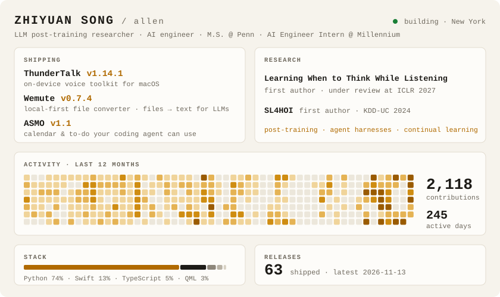

<picture>
  <source media="(prefers-color-scheme: dark)" srcset="assets/board-dark.svg">
  
</picture>

#### `$ ls ~/shipping`

- **[ThunderTalk](https://github.com/realAllenSong/ThunderTalk)**: on-device voice toolkit for macOS. Hotkey dictation, transcription with speaker labels, text-to-speech, voice cloning.
- **[Wemute](https://github.com/realAllenSong/wemute)**: local-first file converter for Mac, with a CLI that turns any file into text for LLMs.

#### `$ ls ~/research`

- *Learning When to Think While Listening in Large Audio-Language Models*, under review at ICLR 2027 · [arXiv](https://arxiv.org/abs/2605.27190) · [code](https://github.com/realAllenSong/Learning-When-to-Think-While-Listening)
- *SL4HOI: Supervised Learning for Predicting Health Opportunity Index across States*, KDD-UC 2024 · [paper](https://kdd2024.kdd.org/wp-content/uploads/2024/08/14-KDD-UC-Song.pdf) · [code](https://github.com/LiranLizqj6pe/SL4HOI-Supervised-Learning-for-Predicting-Health-Opportunity-Index-across-States)

#### `$ tail ~/blog`

- [Routing 260 agent skills with 1.2k tokens: what I measured](https://www.zhiyuansong.com/blog/routing-agent-skills)
- [What I'm building, and the thread through it](https://www.zhiyuansong.com/blog/what-i-am-building)
- [Building ThunderTalk: a local, MLX-powered alternative to Typeless](https://www.zhiyuansong.com/blog/thundertalk-launch)

#### `$ cat ~/.links`

[zhiyuansong.com](https://www.zhiyuansong.com)

The board above is redrawn every day from live GitHub data by <a href="build.py"><code>build.py</code></a>.
